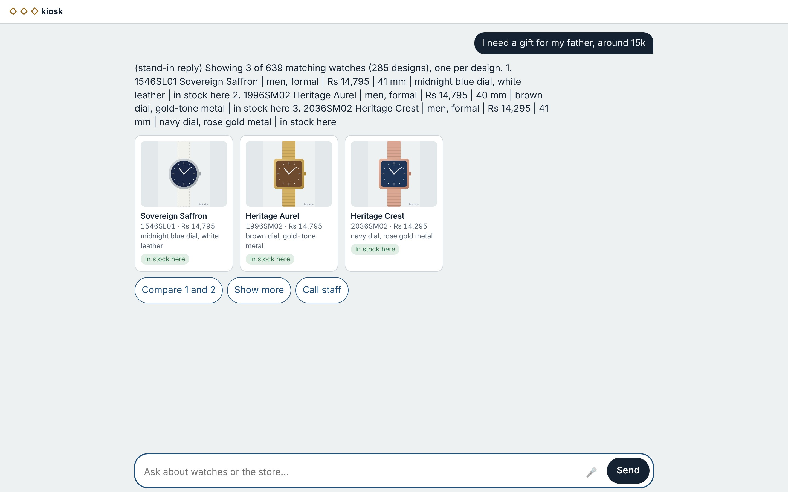
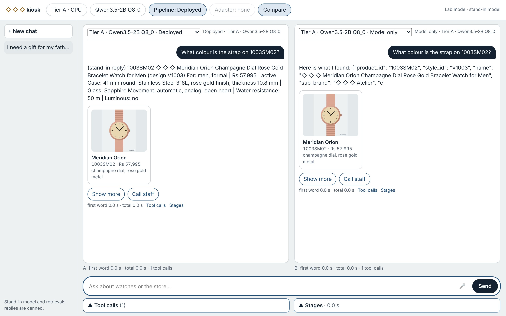
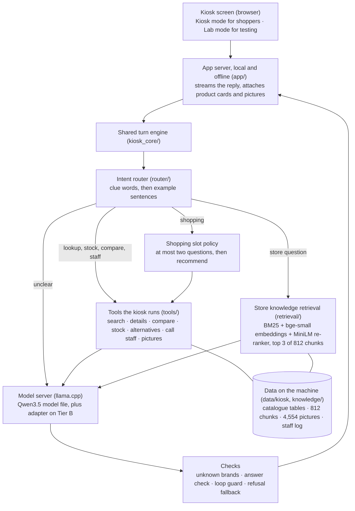

# A small language model as an offline store kiosk assistant

A retail kiosk assistant that runs entirely on one ordinary laptop, with no cloud and no internet: a 2-billion or
4-billion-parameter language model served by [llama.cpp](https://github.com/ggml-org/llama.cpp), grounded in the
store's own catalogue and documents, acting through tools, and answering in English and Hinglish.

The project asks one question: **how practical is it for a retail business to run a kiosk chatbot on locally
deployed, fully offline small language models, on low-cost hardware?** It answers it in five objectives (choose the
model, ground it, build the harness around it, adapt its behaviour, ship the app), each with targets and decision
rules written down before its runs, on a fictional watch store whose every answer is known.

This repository holds everything: the code, the generated data, every result and log, and the five reports.

Undergraduate project, Department of Electrical Engineering, Indian Institute of Technology Kanpur.
Anany Dev Choudhary (Roll No. 228070135), 2026.

| Kiosk mode | Lab mode, two setups compared |
|---|---|
|  |  |

<sub>Screenshots taken with the stand-in model server used for interface tests.</sub>

## Contents

- [Quick start](#quick-start)
- [Running it](#running-it)
- [What gets downloaded](#what-gets-downloaded)
- [Where the system stands](#where-the-system-stands)
- [How it works](#how-it-works)
- [The five objectives](#the-five-objectives)
- [What is in this repository](#what-is-in-this-repository)
- [Results, logs and job data](#results-logs-and-job-data)
- [The fictional data](#the-fictional-data)
- [Write-ups](#write-ups)
- [Reproducing the evaluation](#reproducing-the-evaluation)
- [Using it for another store](#using-it-for-another-store)
- [Limits](#limits)
- [Licence and credits](#licence-and-credits)

## Quick start

Windows 10 or 11, 64-bit, 16 GB of memory, about 10 GB of free disk space and an internet connection for the setup
only.

```bat
git clone https://github.com/ghost-o-xyrus/retailkioskslm_26.git
cd retailkioskslm_26
setup.bat
```

Or download the repository as a zip, unpack it, and double-click **`setup.bat`**. That one step:

1. installs Python 3.13 with `winget` if the computer has no Python 3.10 to 3.13;
2. makes a virtual environment in the folder (`.venv`) with four packages (`requirements.txt`);
3. downloads llama.cpp (processor and Vulkan builds), the two language models, the retrieval models and the
   adapters (about 6 GB, all kept inside the folder);
4. opens **Lab mode** in the browser, with both models and every setup of the project selectable.

Run it again at any time: finished steps are skipped and interrupted downloads resume. Nothing is installed outside
the folder except Python itself, and deleting the folder removes everything else.

## Running it

After setup, three scripts start the three ways of running it. Each has its own ports and its own log folder, so
they can run at the same time.

| Script | What it starts | Page | Model server port | Logs |
|---|---|---|---|---|
| `start_lab.bat` | **Lab mode**: both models, every setup from Objectives 1 to 5, compare view, per-stage timing, tool drawer | http://127.0.0.1:8000 | 8080 | `logs\lab` |
| `start_tier_a.bat` | **Tier A as deployed**, Kiosk mode: processor only, Qwen3.5-2B (8-bit), Objective 3 pipeline | http://127.0.0.1:8001 | 8081 | `logs\tier_a` |
| `start_tier_b.bat` | **Tier B as deployed**, Kiosk mode: integrated graphics through Vulkan, Qwen3.5-4B (4-bit) with the Objective 4 adapter | http://127.0.0.1:8002 | 8082 | `logs\tier_b` |
| `start_side_by_side.bat` | Tier A and Tier B together, in two windows on the left and right halves of the screen | both | both | both |
| `stop_all.bat` | Stops everything started from this folder | | | |

- The tier scripts open a plain window by default. `start_tier_a.bat kiosk` opens it full-screen and locked, as in
  a store (Alt+F4 closes the browser); `left`, `right` or `centre` places the window.
- The tier scripts run the kiosk launcher: the app is restarted if it stops, and the app reloads the model server
  if that stops.
- Everything runs **offline**. After setup the app refuses and logs any connection that would leave the computer
  (`offline_guard.jsonl` in the log folder).
- Tier A and Tier B together use about 8 GB of memory. Running Lab as well loads a third model; close it first on
  a 16 GB machine.
- Tier B needs a graphics chip with a working Vulkan driver (any recent Intel, AMD or NVIDIA driver). Without one,
  Tier A and Lab with the Tier A setups still work.
- The reports' timings were measured with one model server running. Two tiers answering at once share the
  processor, so use side-by-side for comparing answers, not for timing.

## What gets downloaded

No model file is stored in this repository. `setup.bat` runs
[`scripts/fetch_assets.py`](scripts/fetch_assets.py), and [`scripts/assets.json`](scripts/assets.json) lists every
file, its source, and the size and SHA-256 of the copy the results were measured with.

| What | From | To |
|---|---|---|
| llama.cpp for Windows, processor build and Vulkan build | [ggml-org/llama.cpp releases](https://github.com/ggml-org/llama.cpp/releases), the build recorded in `assets.json` | `runtime\llama-cpu`, `runtime\llama-vulkan` |
| Qwen3.5-2B, 8-bit (`Q8_0`), the Tier A model | [unsloth/Qwen3.5-2B-GGUF](https://huggingface.co/unsloth/Qwen3.5-2B-GGUF) | `runtime\models\qwen3.5-2b` |
| Qwen3.5-4B, 4-bit (`Q4_K_M`), the Tier B model | [unsloth/Qwen3.5-4B-GGUF](https://huggingface.co/unsloth/Qwen3.5-4B-GGUF) | `runtime\models\qwen3.5-4b` |
| Retrieval models in OpenVINO form: `bge-small-en-v1.5` embedder, `ms-marco-MiniLM-L-6-v2` re-ranker (8-bit) | this repository's release `v1.0` (`retrieval_models_ov.zip`) | `models\ov` |
| The Objective 4 adapters (GGUF); Tier B deploys `lora_4b` | this repository's release `v1.0` (`adapters_gguf.zip`) | `finetune\adapters_gguf` |

To download by hand, or only part:

```bat
.venv\Scripts\python scripts\fetch_assets.py --check              what is present, what is missing
.venv\Scripts\python scripts\fetch_assets.py --only models        only the two language models
.venv\Scripts\python scripts\fetch_assets.py --only tier-a        only what Tier A needs
.venv\Scripts\python scripts\fetch_assets.py --build-retrieval    build the retrieval models here instead
```

If the recorded llama.cpp build is no longer offered, setup uses the newest one and says so. If a model file's
SHA-256 differs from the recorded one, setup says that too: replies can then differ slightly from the reports.

## Where the system stands

The deployed setup of each tier and its latest measured numbers, on the test laptop (Intel Core i5-1240P, 16 GB,
Intel Iris Xe). Quality is from the Objective 3 test set; timing and memory are from Objective 5, through the app.

| | Tier A · processor only | Tier B · integrated graphics |
|---|---|---|
| Model | Qwen3.5, 2 billion parameters, 8-bit | Qwen3.5, 4 billion parameters, 4-bit |
| Setup | Objective 3 pipeline, no adapter | Objective 3 pipeline + adapter, short replies |
| Store questions right | 69.6% | 81.4% (before the adapter) |
| Tool tasks right | 77.6% | 83.3% (before the adapter) |
| Shopping dialogues that fit the request | 97% | 97% |
| Reply time, median / 90th percentile | 6.7 / 18.9 s | 6.2 / 13.1 s |
| First word on screen, median | 3.6 s | 0.9 s |
| Peak memory (budget) | 3.2 GB (5) | 4.7 GB (10) |
| Unsupported claims on unanswerable questions (blind judge) | 37% | 23% (before the adapter) |

The Tier B adapter was judged on development data only (ties on every set); its test-set round waits for real
store data. What is not good enough yet is listed under [Limits](#limits).

## How it works

One customer message travels top to bottom. Everything runs on the kiosk machine.



- **Code decides, the model talks.** Lookups, stock checks, comparisons and staff hand-offs are run by the kiosk
  itself; the model words the reply from their results. Only unclear messages let the model choose a tool.
- **Facts come from retrieval, not from the model's memory.** Store questions are answered from the top three
  retrieved chunks, with a calibrated refusal when nothing relevant is found.
- **The harness and the app share one turn engine**, so what was measured is what runs: 160 of 160 development
  replies were identical between the two.

The tools the model sees are `search_catalogue`, `get_product_details`, `compare_products`, `check_inventory`,
`get_alternatives` and `call_staff` ([`tools/schemas.json`](tools/schemas.json)); the kiosk adds
`show_product_images` and retrieval.

## The five objectives

| | Objective | What was done | Main result |
|---|---|---|---|
| 1 | Choose the model | Six open models of 0.8 to 4 billion parameters, two number formats, 370 kiosk cases, speed and memory on both backends | Qwen3.5-4B (4-bit) for the graphics tier, 81% of test cases; Qwen3.5-2B (8-bit) for the processor tier, 74% |
| 2 | Ground it | Hybrid retrieval with a re-ranker over 812 chunks, and a refusal fallback | 92% recall at 5; the 4B's store answers rose from 50% to 78% |
| 3 | Build the harness | Router, kiosk-run tools, slot policy, checks: thirteen changes on development data, confirmed once on 775 test cases | 2B: store questions 51.9 → 69.6%, tool tasks 62.5 → 77.6%; dialogues 97% fit |
| 4 | Adapt the behaviour | LoRA adapters trained on a second fictional catalogue | 2B adapter: honest declines 62 → 97% (development data), but it failed the speed rule on the processor; Tier B deploys the 4B adapter |
| 5 | Ship the app | Kiosk and Lab modes, per-stage measurement, offline package, scenario walkthroughs | App adds at most 0.4% to reply time; 7 of 9 criteria met |

**The method was the same throughout.** Targets and decision rules were fixed before each run. Changes were chosen
on development data and each test set was used once. Comparisons are paired on the same cases, with bootstrap 95%
intervals, a measured noise bound and Holm adjustment. Automatic checks against known answers come first; reply
quality is scored by a blind judge (a language model from a different family than the candidates), checked against
the author's own labels.

## What is in this repository

```
setup.bat  start_lab.bat  start_tier_a.bat  start_tier_b.bat  start_side_by_side.bat  stop_all.bat
scripts/          setup and download scripts (fetch_assets.py, assets.json, fetch_large_files.py)

app/              the kiosk app: server, Kiosk and Lab pages, launcher, packager, measurement, walkthroughs
kiosk_core/       the turn engine shared by the harness and the app; the offline guard
harness/          the evaluation harness, and every run plan of the project (harness/plans/)
router/           the intent router and its example sentences
retrieval/        BM25, embeddings, re-ranker, fallback, OpenVINO runtime, benchmarks
tools/            the kiosk tools over the catalogue, and their schemas
knowledge/        the 812 knowledge chunks, the retrieval test set, and their builders
eval/             evaluation sets, system prompts, scorers, verdict scripts, the judge packets
finetune/         Objective 4: training-data builders, training scripts, plans, training outputs
kaggle/           runs jobs on Kaggle and brings their files back; every job's log (kaggle/_pulled/)

data/  data_v1/  data_train/      the three generated catalogues (clean copy, kiosk copy, defects, documents)
generate_catalogue.py  validate.py  data_dictionary.md

results/  results_obj2/  results_retrieval/  results_obj3/  results_obj4/  results_obj5/      results by objective
logs/             run-time logs of the app, the model server and the kiosk launcher

writeups/         the five reports (PDF), the six slide decks, and the reports' LaTeX and figure sources
docs/             RESULTS.md, DATA.md, REPRODUCE.md, ENVIRONMENT.md, LARGE_FILES.md
publish/          how this repository was assembled from the project folder, and what was scrubbed
```

Each code folder has its own `README.md`. [`harness/README.md`](harness/README.md) is the step-by-step record of
every run.

Folder names are the ones the code writes to and reads from, which is why results are in `results/`,
`results_obj2/` and so on rather than under one parent: every plan and script still finds its files.

## Results, logs and job data

- **[`docs/RESULTS.md`](docs/RESULTS.md)** indexes every results folder: what it is, how many files, and its
  report. Most step folders have a `report.md` or verdict file that states the rule, the numbers and the decision.
- **Per-case outputs**: each run folder has the model's reply, tool calls, timings, token counts and memory for
  every case, plus the run's settings (`run_meta.json`) and summary.
- **Kaggle jobs**: `kaggle/_pulled/<job>/` has each job's log and returned files; `kaggle/jobs.json` defines them.
- **Logs**: `logs/` has the app's per-turn logs, the model server's log and the launcher's logs from the laptop.
- **Large files**: files too big for GitHub are zip archives on Google Drive, listed with sizes, checksums and
  links in **[`docs/LARGE_FILES.md`](docs/LARGE_FILES.md)**. `python scripts\fetch_large_files.py` downloads them
  and unpacks them into place. The kiosk does not need them.
- **Environment**: [`docs/ENVIRONMENT.md`](docs/ENVIRONMENT.md) has the laptop, the llama.cpp build and every
  package version.

## The fictional data

Everything the kiosk knows was generated for this project from a fixed random seed, so it rebuilds exactly and
every answer can be scored against a known truth. No real company's products, prices or policies are in it, and the
brand name in the files is invented.

- `data/`: the store. 651 designs, 1,518 product variants, 5 stores, 7,590 stock rows, 6 offers, 4,554 pictures and
  8 store documents, in a clean copy (the truth) and a kiosk copy with 1,838 logged defects (abbreviations, mixed
  units, missing values, stale stock, contradictions).
- `data_v1/`: the smaller catalogue Objective 1 used.
- `data_train/`: a separate 1,480-product catalogue for Objective 4's training data, sharing no name or code with
  the store, so adapters learn behaviour and not facts.

[`docs/DATA.md`](docs/DATA.md) describes the tables and how to rebuild them;
[`data_dictionary.md`](data_dictionary.md) explains every column.

## Write-ups

| Objective | Report | Slides | Date |
|---|---|---|---|
| 1. Choosing the model | [PDF](writeups/reports/objective1_report.pdf) | [deck](writeups/decks/objective1_deck.pptx) | 11 September 2026 |
| 2. Grounding it in store knowledge | [PDF](writeups/reports/objective2_report.pdf) | [deck](writeups/decks/objective2_deck.pptx) | 23 September 2026 |
| 3. Building the harness | [PDF](writeups/reports/objective3_report.pdf) | [deck](writeups/decks/objective3_deck.pptx) | 15 October 2026 |
| 4. Adapting the behaviour | [PDF](writeups/reports/objective4_report.pdf) | [deck](writeups/decks/objective4_deck.pptx) | 29 October 2026 |
| 5. The kiosk app | [PDF](writeups/reports/objective5_report.pdf) | [deck](writeups/decks/objective5_deck.pptx) | 7 November 2026 |
| Objectives 1 to 5 in one deck | | [deck](writeups/decks/project_overview_deck.pptx) | 7 November 2026 |

`writeups/source/` has each report's LaTeX source and the script that draws its figures.

## Reproducing the evaluation

Every run was started from a plan file, so a run is one command:

```bat
.venv\Scripts\activate
pip install -r requirements-dev.txt
set SLM_BASE_DIR=%CD%\runtime
python -m unittest discover -s . -p "test_*.py"
python harness\run_plan.py harness\plans\obj3_step14.json --dry-run
python harness\run_plan.py harness\plans\obj3_step14.json
```

[`docs/REPRODUCE.md`](docs/REPRODUCE.md) lists the plan and scoring command for each objective, and what will and
will not match on another machine.

## Using it for another store

Nothing in the engine is specific to watches. The store-specific parts are data and settings, and each is rebuilt by
a script already here:

1. Put the store's catalogue into the files in `data/kiosk/` (same columns) and its documents into `data/docs/`.
2. Rebuild the knowledge chunks (`knowledge/build_corpus.py`) and recalibrate the retrieval fallback
   (`retrieval/calibrate_fallback.py`).
3. Adjust the tool descriptions and the router's example sentences (`tools/schemas.json`, `router/`) to the
   store's product attributes.
4. Rebuild the evaluation sets and rerun the confirming plan before trusting it.

The same steps apply when real data replaces the fictional store. The two tiers are also a choice, not a
requirement: any GGUF model and any llama.cpp backend can be put in a plan file and selected in Lab mode.

## Limits

Stated in the reports and still true:

- **Unsupported claims.** The 5% target was missed in every objective: a blind judge still finds unsupported claims
  in 23% (4B) and 37% (2B) of replies to unanswerable questions.
- **Facts in free text.** In the walkthrough, Tier A stated a wrong price and no check caught it; nothing yet
  compares prices in a reply with the tool results.
- **Waiting time on the processor.** On Tier A the first word of a store answer comes after 7.3 seconds at the
  median and after 16 to 19 seconds in the slow tail. In informal use this is the main reason the app does not yet feel satisfactory.
- **A network attempt at start-up.** Once per app start something tries to reach an analytics address. The offline
  guard refuses and logs it, but its source is not yet identified.
- **Tier B's colour follow-up.** With the adapter, "does it come in black?" in Hinglish is answered for the variant
  on screen rather than for the design.
- **Fictional data only, and no user test.** Results describe a generated store. The adapters were judged on
  development data; the final training round, a fresh test set and a test with shoppers wait for real store data.
- **One machine.** Both tiers were measured on one laptop.

## Licence and credits

The code, the generated data and the write-ups are under the [MIT licence](LICENSE).

Not part of this repository and under their own licences: the Qwen3.5 model files (downloaded from Hugging Face),
and llama.cpp (MIT). The release assets contain converted copies of
[`BAAI/bge-small-en-v1.5`](https://huggingface.co/BAAI/bge-small-en-v1.5) (MIT) and
[`cross-encoder/ms-marco-MiniLM-L-6-v2`](https://huggingface.co/cross-encoder/ms-marco-MiniLM-L-6-v2) (Apache 2.0),
and LoRA adapters trained for this project on top of the Qwen3.5 models.

An AI coding assistant helped write and debug parts of the code, and a language model served as the blind judge
described above.

To cite this work, see [`CITATION.cff`](CITATION.cff).
